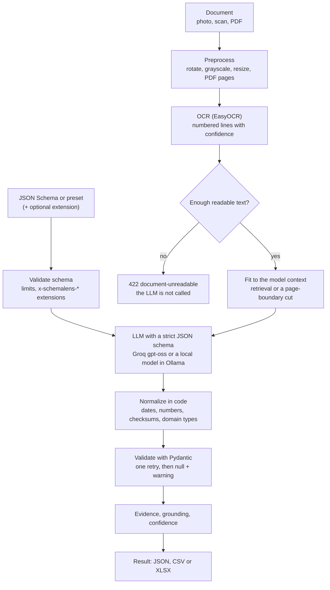

# How it works



All of it lives in `packages/core` (plain Python). Settings come from the environment through
`schemalens_core.config.Settings`; see [`.env.example`](../.env.example).

## Pipeline

1. **Preprocess** (Pillow): EXIF rotation, grayscale, longest side ≤ `MAX_IMAGE_SIDE`; PDF pages with
   a text layer are read directly (confidence 1.0), others rendered with pypdfium2.
2. **OCR** (EasyOCR, `OCR_LANGS`): text with boxes and confidence, put into reading order and
   numbered `[L001]`, `[L002]`, …
3. **Quality gate**: at least `OCR_MIN_LINES` lines and a length-weighted mean confidence of at least
   `OCR_MIN_MEAN_CONF`; otherwise `document-unreadable` and no LLM call. A few uncertain fragments are
   the shortest way to invented values.
4. **Context budget**: `min(<profile>_DIRECT_LIMIT, context window − prompt − reserved answer)`. Text
   that fits goes whole (`usage.context = full`). Longer text: retrieval (multilingual embeddings,
   in-memory Chroma) picks the lines closest to the schema fields (`retrieval`); without the embedding
   model, a cut at a page boundary with a warning (`truncated`).
5. **LLM** with `response_format = json_schema` (strict on Groq, grammar on Ollama): a value, evidence
   line ids and a model confidence per field. The prompt is domain-neutral and forbids guessing; the
   document is untrusted data, not instructions.
6. **Normalization in code**: dates, numbers and `x-schemalens-type` values. Every change of a value
   is reported in `warnings`.
7. **Validation** (Pydantic, built from the schema): one LLM retry only for fields that still fail;
   after a second failure the field is `null` with a warning.
8. **Evidence and confidence** (below).

## Confidence per field

Computed by the service; the model's own confidence is only one input (models happily return 1.0
for everything).

```
no value (null)            → 0
with evidence              → base = w · mean OCR confidence of the evidence lines + (1 − w) · model confidence
without evidence           → base = model confidence · CONF_NO_EVIDENCE_FACTOR
value changed by a normalizer          → × CONF_NORMALIZED_FACTOR
field fixed in the validation retry    → × CONF_RETRY_FACTOR
failed checksum (NIP, REGON, PESEL, IBAN) → × CONF_CHECKSUM_FACTOR
derived field without evidence         → base = min(model confidence, CONF_DERIVED_CAP), no penalty
date / number / identifier not found in its evidence → × CONF_GROUNDING_FACTOR
plain text with tokens typical of OCR misreads       → × CONF_SUSPICIOUS_FACTOR
```

Defaults: `w = 0.7`, no evidence `0.5`, normalized `0.9`, retry `0.85`, checksum `0.5`, derived cap
`0.7`, grounding `0.3`, suspicious `0.6`. Penalties multiply.

- **Grounding.** A model can cite the right line and still return a wrong value (`30.06.2027` →
  `3006-07-20`). For values code can parse (dates, numbers, identifiers) the evidence lines are run
  through the same normalizer; a value matching no candidate gets a warning and the penalty.
- **OCR noise in text.** Plain text fields are never "corrected" (we cannot know what was meant), but
  tokens such as `Sp. Z 0.0`, `P0lska` or `example. com` get a `possible OCR noise` warning and a lower
  confidence.
- **Too broad evidence.** Evidence that covers more than `CONF_EVIDENCE_MAX_LINES` lines or
  `CONF_EVIDENCE_MAX_SHARE` of the document says nothing and is treated as missing.

## Live progress

`Pipeline.extract(..., progress=callback)` reports `reading`, `read` and `extracting` with counts and
timings only. The API turns it into the NDJSON stream of `?stream=true` (see [api.md](api.md)).

## Privacy

Documents live in memory for the duration of a request. Nothing is written to disk or a database,
and logs carry metadata only (status, sizes, page counts, timings, the model). The only state on AWS
is the rate-limit counters: a salted hash of the client address, the day and a number, deleted after
two days.
